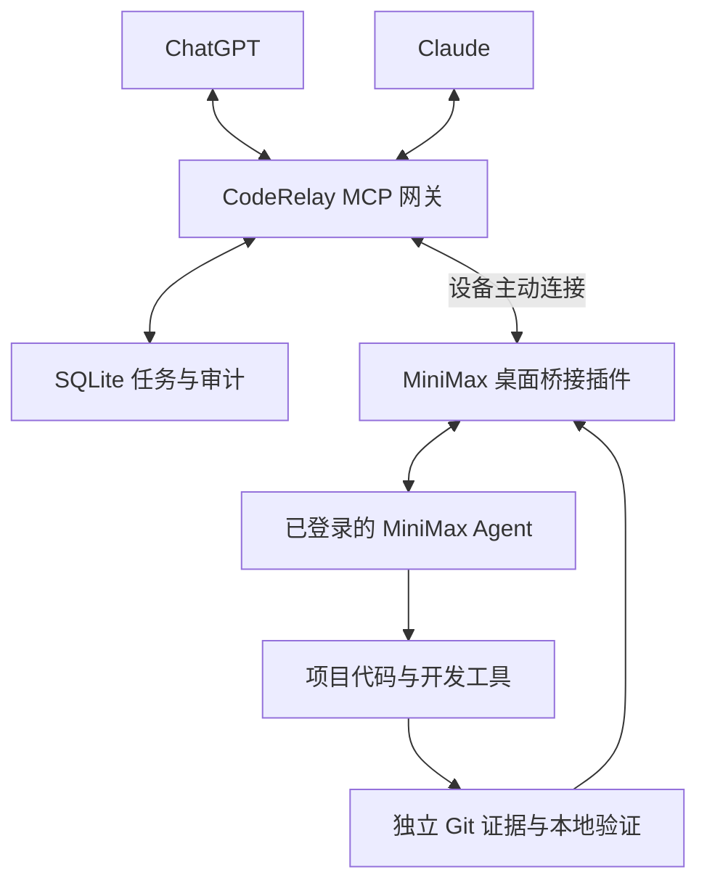

# CodeRelay · 代码接力

[](https://github.com/Shermanxwz/CodeRelay/actions/workflows/ci.yml)

**让 ChatGPT、Claude 把开发任务交给你设备上已经登录的 MiniMax Code。**

CodeRelay 提供统一 MCP 入口、持久化任务队列和 MiniMax 桌面 Mini App。MiniMax 使用自己的 Agent、模型和工具修改项目、运行命令；上层客户端读取实际进度、Git 差异与验证结果，再继续任务。

> 当前版本：**0.1.0，首次候选发布**。生产代码调用真实 MiniMax Host API，没有模拟执行后备路径。自动测试使用明确标注的 Host fixture；真实已登录 MiniMax Desktop、ChatGPT/Claude 账号接入和实际额度尚需按[实机验收](docs/acceptance.md)完成验证。CI 通过不等于这部分已经验收。

## 能做什么

- ChatGPT、Claude 共用一个远程 MCP，支持传统 MCP 初始化与 `2026-07-28` 协议。
- MiniMax 桌面插件复用宿主已有授权，在当前项目中创建专用开发会话。
- 异步提交、查询、继续、追加要求、取消，以及子会话审批和问卷回传。
- SQLite 持久化任务、事件、命令回执和审计；重启保留执行状态。
- 请求键幂等、事件序号校验、真实工作区互斥；未知结果不自动重跑。
- 实际模型记录、独立 Git 证据、由本地用户配置的验证命令和真实退出码。
- OAuth PKCE、一次性连接码、可撤销设备／客户端凭据、限定读写权限。
- 无前端 CDN、无分析脚本；桌面插件运行时只使用 Node 内置模块。

## 架构



网关不执行用户发来的 shell 命令。开发由 MiniMax Host 执行；桥接插件的独立验证只运行设备主人事先配置的 argv 命令。MiniMax 自己的登录凭据不会被导出到网关。

## 快速开始

需要 Node.js **24 或 26**。打包发布时另需 Python 3，运行网关和安装桌面插件都不需要 Python。

### 1. 启动网关

```sh
git clone https://github.com/Shermanxwz/CodeRelay.git
cd CodeRelay
npm ci
npm run build
node dist/src/cli.js init --public-url https://relay.example.com
node dist/src/cli.js serve
```

把 `relay.example.com` 换成自己的域名，并为本地 `127.0.0.1:8787` 配置 HTTPS 反向代理。配置保存在 `~/.coderelay`；管理员密钥自动生成并私密保存，不会在初始化输出中显示。`init` 不会覆盖现有配置。

只在本机开发测试时可以省略 `--public-url`，使用默认 `http://127.0.0.1:8787`。云端 ChatGPT／Claude 无法用这个地址访问你的电脑。

推荐的完整容器部署见 [部署与维护](docs/operations.md)，仓库提供 `Dockerfile`、`compose.yaml` 和 Caddy 配置。

### 2. 安装 MiniMax 桌面插件

需要已登录的 **MiniMax Code 3.1.6 或更新兼容版本**。下载 Release 中的 `coderelay-minimax-0.1.0.zip`，或直接复制仓库的 `plugins/minimax-coderelay` 整个目录。

安装后应有这个文件：

```text
<MiniMax数据目录>/plugins/minimax-coderelay/.minimax-plugin/plugin.json
```

默认 MiniMax 数据目录通常为 macOS 的 `~/.minimax`、Windows 的 `%USERPROFILE%\.minimax`；以你实际配置的目录为准。复制时保留隐藏的 `.minimax-plugin` 目录。桌面插件无需 `npm install`。

重启 MiniMax Code，启用插件，在需要开发的**本地项目会话**里打开 CodeRelay。详细步骤与官方契约来源见[插件安装文档](plugins/minimax-coderelay/README.md)。

### 3. 配对设备并绑定项目

在网关主机另开终端：

```sh
node dist/src/cli.js pair --name "我的开发机"
```

将网关 HTTPS 地址和输出的五分钟一次性配对码填到 MiniMax 内的 CodeRelay 页面。然后点击 **绑定当前项目**、按需要设置 **本地验证命令**，再点击 **开始接单**。

插件只创建、继续自己的专用会话。它会从宿主验证项目目录，拒绝没有项目的默认工作区；不会接管其他聊天。保持开发机在线、MiniMax 和桥接服务运行。

### 4. 连接 ChatGPT 或 Claude

统一 MCP 地址：

```text
https://relay.example.com/mcp
```

先在网关主机生成一次性授权码：

```sh
node dist/src/cli.js connector-code
```

- **ChatGPT：** 添加自定义 MCP 插件，填写上述 URL，选择 OAuth；使用动态客户端注册（DCR），在 CodeRelay 授权页输入一次性授权码。
- **Claude：** 添加自定义远程连接器，填写同一 URL，并完成 CodeRelay OAuth 授权。
- **Claude Code：** `claude mcp add --transport http CodeRelay https://relay.example.com/mcp`，再按客户端提示授权。

账户、工作区和具体客户端是否提供相应入口，以其实际功能和管理员策略为准。每次连接使用独立的一次性授权码。网关实现 DCR + PKCE，没有宣称支持未实现的 CIMD 或特定产品私有授权扩展。

现在可以请求：

> 使用 CodeRelay 列出项目。在我指定的项目里完成这项修改，运行已经配置的本地验证，返回 Git 差异与真实退出码。沿用同一个任务 ID 检查进度；遇到未知结果先核对状态，不要重复提交。

## MCP 工具

| 工具                                   | 用途                             |
| -------------------------------------- | -------------------------------- |
| `list_devices` / `list_projects`       | 查看已授权设备和项目             |
| `submit_task`                          | 提交任务并返回持久任务 ID        |
| `list_tasks` / `get_task`              | 查看状态与摘要                   |
| `get_events`                           | 分页读取进度、审批和问卷事件     |
| `get_result`                           | 有界读取结果、Git 证据和验证结论 |
| `continue_task`                        | 在同一项目中继续已结束的任务     |
| `steer_task`                           | 向运行中的 Agent 追加要求        |
| `cancel_task`                          | 请求停止，等待实际确认           |
| `reply_permission` / `answer_question` | 转交用户的明确决定               |

每次新写操作提供 8–128 字符的 `requestKey`；同一请求重试沿用原值。同键不同参数会被拒绝。读取需要 `tasks:read`，写入需要 `tasks:write`。设备凭据、客户端凭据与管理员凭据不能混用。

大结果和大事件按偏移分片；后续结果页可以携带 `expectedSha256` 以检测内容变化。完整字段、状态机和端点见 [协议](docs/protocol.md)。

## 任务状态与真实验收

| 状态               | 含义                                   |
| ------------------ | -------------------------------------- |
| `queued`           | 已保存，等待设备领取                   |
| `running`          | 已分配给设备并在执行                   |
| `waiting_input`    | 正在等审批或问卷                       |
| `cancel_requested` | 已请求取消，尚未确认停下               |
| `succeeded`        | Agent 工作流结束；验证结论另外读取     |
| `failed`           | 明确失败，包括本地验证失败             |
| `cancelled`        | 已确认取消，或排队任务尚未启动就被取消 |
| `unknown`          | 无法证明执行结果，继续锁住设备／工作区 |

`succeeded` 不代表测试一定通过。`get_result` 会独立报告验证是通过、失败、未请求、未运行、没有报告或未完成。Git 差异来自实际工作区；测试退出码来自真正的验证子进程，不从 Agent 的文字推断。

发生断线、失租、宿主异常或插件重启后，系统不会自动重跑可能已经产生副作用的工作。先检查设备和会话，确认进程状态与文件变化，再执行：

```sh
node dist/src/cli.js reconcile --id TASK_ID --outcome failed --reason "已检查宿主进程和工作区，确认任务停止，记录实际文件变化"
```

之后在插件里检查管理员处理结果；必要时重新绑定专用会话。详细恢复步骤见[运行手册](docs/operations.md)。

## 开发与验证

```sh
npm ci
npm run check
npm run package
```

自动验证包括持久化与并发、权限隔离、OAuth、官方 MCP Client 的新旧协议、真实 HTTP 网关与插件桥接、真实 Git／验证子进程，以及 UI 交互。测试不访问真实 MiniMax 账户，不消耗模型额度。

GitHub Actions 使用公开仓库的标准托管运行器：Linux、Windows、macOS 的 Node 24，以及 Linux Node 26；另有容器启动检查、依赖审计、可重复打包与校验和验证。查看[当前工作流](https://github.com/Shermanxwz/CodeRelay/actions)的具体运行和 SHA。

## 范围与部署边界

- 当前是**单一拥有者、单网关、本地 SQLite 卷**的部署；不支持共享给互不信任租户，不支持 SQLite 放在 NFS。
- 每台设备同时执行一个任务；未知任务会阻塞该设备后续工作。
- 桌面宿主退出会影响执行。无界面 CLI 执行器不在当前版本内。
- Mini App Node 及 Agent 不是操作系统沙箱；权限由 MiniMax、操作系统和项目配置共同决定。
- 代码、Git 差异与验证输出会传到你的网关，并在你请求时返回 MCP 客户端。敏感信息过滤不是完整的秘密扫描器。
- 开发任务的模型费用按 MiniMax 中实际选择的供应商与账户计费。ChatGPT／Claude 的外层对话仍有自身用量。
- 安全报告、凭据处理和更新要求见 [SECURITY.md](SECURITY.md)。

采用 [MIT License](LICENSE)。
